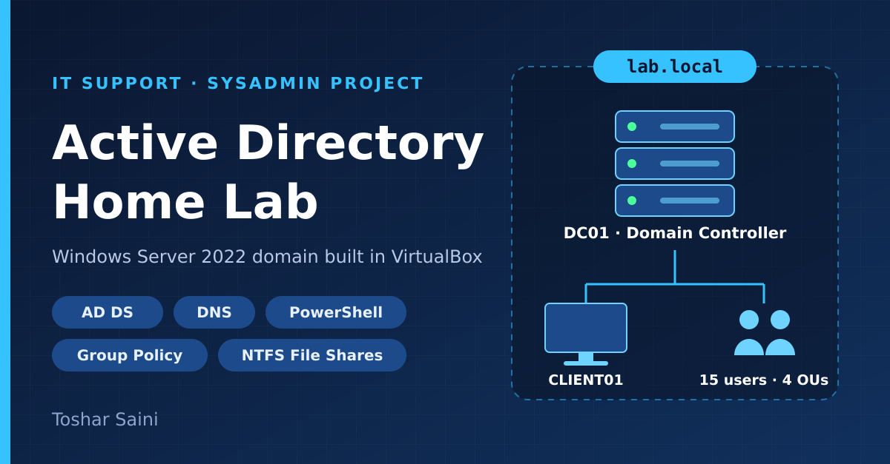
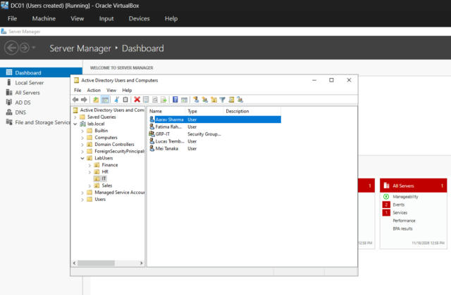
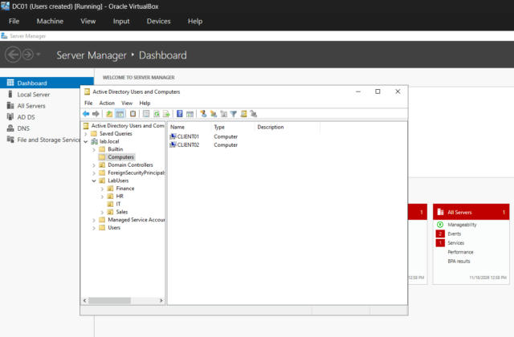
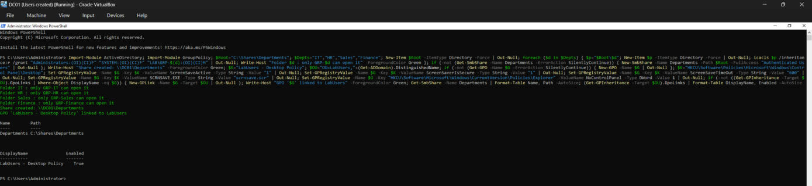
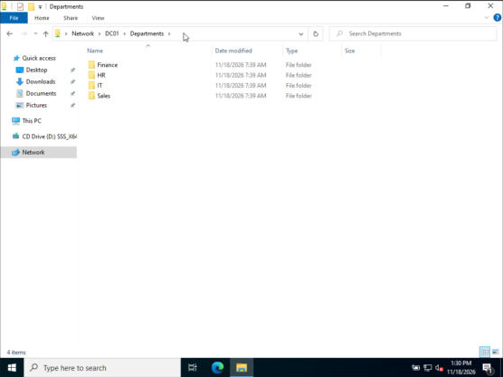
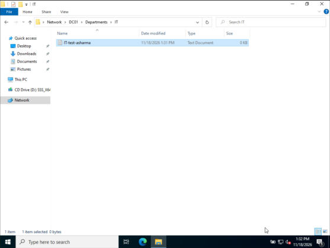
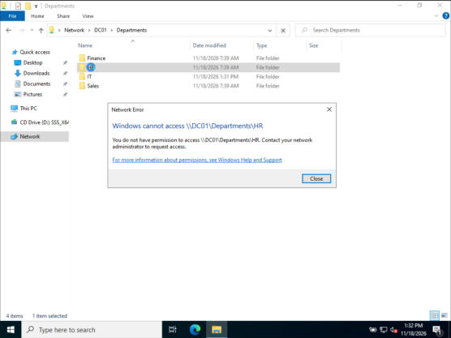
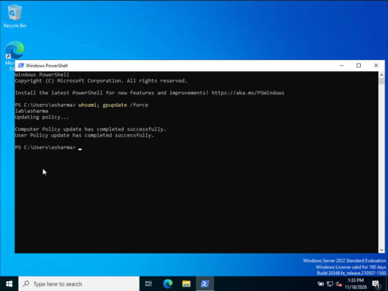
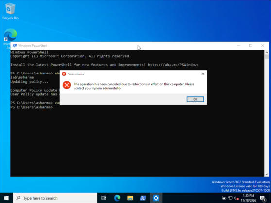
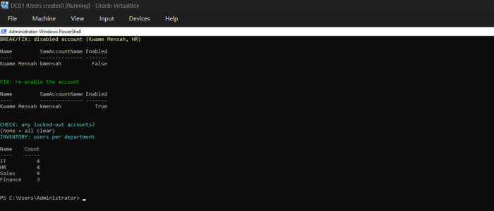

# Active Directory Home Lab

A small-company Windows domain built from scratch in VirtualBox to practise real IT support and system administration tasks.

## What I built

| Machine | Role | OS |
|---|---|---|
| **DC01** (10.0.2.10) | Domain controller, DNS, file server | Windows Server 2022 |
| **CLIENT02** | Domain-joined employee machine | Windows Server 2022 (Desktop Experience) |

- **Domain:** `lab.local`
- **Network:** isolated VirtualBox NAT Network (`LabNet`, 10.0.2.0/24)
- **Users:** 15 accounts across 4 departments (IT, HR, Sales, Finance), each in its own OU and security group

## Skills shown

- Installing Windows Server and promoting a domain controller (AD DS + DNS)
- Bulk user, OU and group creation with **PowerShell** from a CSV file
- Joining a computer to the domain and renaming it
- **NTFS + SMB permissions:** each department can only open its own folder
- **Group Policy:** screen lock after 10 minutes, Control Panel blocked for standard users
- Help-desk tasks: password resets, disabling and re-enabling accounts, checking for locked-out users
- Troubleshooting: Windows 11 VM freezing on a black screen, traced to Windows' hypervisor (virtualization-based security) forcing VirtualBox into a slow mode; worked around by using a Windows Server client

## Scripts

| Script | What it does |
|---|---|
| `script/01-configure-dc01.ps1` | Static IP, DNS and computer name for DC01 |
| `script/02-install-adds.ps1` | Installs AD DS and creates the `lab.local` forest |
| `script/03-create-ous-groups-users.ps1` + `users.csv` | Creates OUs, security groups and 15 users |
| `script/04-file-share-and-gpo.ps1` | Creates `\\DC01\Departments` with per-department permissions and the desktop Group Policy |

## Screenshots

Step-by-step build screenshots (VirtualBox setup, server install, domain controller promotion) are in the [`AD`](AD) folder. The finished lab is shown below.

**1. IT department users in Active Directory**

**2. Computers joined to the domain**

**3. Department share and Group Policy created with PowerShell**

**4. Department share opened from the client**

**5. IT user can create files in the IT folder**

**6. IT user is denied access to the HR folder**

**7. Domain user signed in and Group Policy applied**

**8. Group Policy blocks Control Panel**

**9. Break/fix: disabled account found and re-enabled**

## Problems I solved

- **VirtualBox network option missing** → switched VirtualBox from Basic to Expert mode.
- **Script would not run (`.ps1.txt`)** → Windows had hidden a `.txt` extension; renamed the file.
- **Windows 11 client stuck on a black screen** → VirtualBox log showed it was running under Windows' hypervisor (native API) instead of VT-x. Turned off Memory Integrity and the hypervisor launch setting; when virtualization-based security still stayed on, built the client from Windows Server instead.
- **Domain join succeeded but rename failed ("account already exists")** → an old computer object `CLIENT01` was still in AD; renamed the new machine to `CLIENT02`.
- **New password rejected** → learned the default domain password policy (length, complexity, history).

## What I would add next

- Mapped network drive through Group Policy
- Automated backups of the department share
- Monitoring with Zabbix or Grafana
- A second domain controller for redundancy
